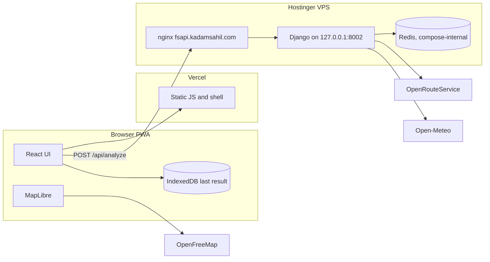
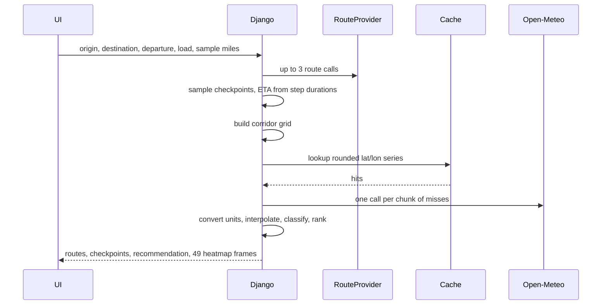

# Plan: Weather-aware truck routing

Candidate review is folded in below. The build follows this document.

Take-home for Spotter AI, Full Stack Developer. Due **15 Nov 2026, 10:20 PM IST**. Budget **16 hours**. Score is 40% route / weather / risk / recommendation, 40% UI / map / heatmap smoothness, 15% code quality, 5% docs and the Loom. Correctness and clarity beat extra features.

## Locked decisions

| Topic | Choice | Why |
|---|---|---|
| Routing | **OpenRouteService `driving-hgv`** on `https://api.heigit.org` | Only free API with a truck profile and a weight restriction. See the comparison below. |
| Three routes | Alternatives when the haul is ≤ 100 km; otherwise one direct route plus two via-point routes | Hosted ORS refuses `alternative_routes` above 100 km. A real haul needs another way to get three options. |
| Provider swap | One `RouteProvider` interface. OSRM is the fallback implementation, not the default | The UI and the risk code never import a vendor. |
| Weather | Open-Meteo forecast, no key | Free, hourly, multi-coordinate, mph and inch units. |
| Wind number | **Sustained** `wind_speed_10m` in mph, for every wind and load rule. Gust is display-only | The brief says wind speed. Gust is shown on the checkpoint and never enters the classifier. |
| Rain number | Open-Meteo `rain`, not `precipitation` | `precipitation` includes snow water-equivalent, so using it would count snow twice. |
| Snow units | Read `hourly_units.snowfall`. If `cm`, divide by **2.54**. If `inch`, use it | Depth in inches, not the “divide by 7” water-equivalent note. |
| Shared rain/snow edges | The worse class wins | 0.25 in/hr is High. 0.50 in/hr is Severe. 1.00 stays Severe (`> 1.00` is the no-travel test). |
| Wind gaps | Next band’s lower bound is exclusive | 34.9 mph is Moderate. 35.0 is High. No gap, no overlap. |
| Load edges | Strict `>` as written | 30,000 lb does **not** upgrade 45–54 mph. 40,000 lb does **not** upgrade 35–44 mph. |
| Sort | Exactly the brief: fewest Severe miles, then fewest High miles, then lowest average risk, then shortest travel time, then route `id` | No extra no-travel key and no distance key. No-travel miles stay in the summary and raise a visible warning. |
| Map | MapLibre GL + OpenFreeMap `positron` | Vector, free, no key, gray basemap so risk colors stay readable. |
| UI kit | **HeroUI v3** (`@heroui/react` + `@heroui/styles`) on Tailwind v4 | Controls, cards, chips, slider, navbar, alerts, autocomplete, date and time, tabs, and the mobile drawer. Accent overridden from the default blue to terracotta. |
| App shape | Installable PWA. Static UI on Vercel. Django on the existing VPS, port **8002** | Isolated from the `spotter` compose project on port 8001. |
| Server state | None. No accounts, no database tables | Django still has a throwaway sqlite file because the framework requires `DATABASES`. |

Confirmed in review, and not open for reinterpretation:

1. Sustained `wind_speed_10m` is the only wind input, including the load rules. `wind_gusts_10m` is stored and shown.
2. The sort is the brief’s four keys, then `id`. No-travel miles do not move a route up or down. A route with No Travel miles gets a warning the driver can see.

## Routing recommendation

| | OpenRouteService `driving-hgv` | Public OSRM | GraphHopper free |
|---|---|---|---|
| Auth | Free key. Standard plan: **2,000 directions / day, 40 / minute** | No key | Free key. **500 credits / day**. An alternative-route call costs 2 credits |
| Truck profile | `driving-hgv`, `vehicle_type: hgv`, weight in metric tons, height, width | Car (also foot, bike). No weight | Free plan is **car, bike, foot only**. `truck` and `small_truck` are paid |
| Three routes | `alternative_routes.target_count` up to 3, **only if the route is ≤ 100 km** | `alternatives=n` is “up to n”. Often one or two. Not guaranteed | `algorithm=alternative_route` on the car profile. Max 5 points on the free plan |
| Longest route | 6,000 km, including with profile restrictions | Demo server, no SLA | Free tier has no rate guarantee |
| Fit for this brief | Primary | Fallback if the key is missing or ORS returns 429/5xx | Skip |

Why not the other two. The product is a truck with a load weight. A car profile will send it down roads the weight restriction was supposed to avoid, and the public OSRM server is a demo (about 1 request/second, no uptime promise, a `User-Agent` is required). GraphHopper’s truck profiles are not on the free plan, so it has the same functional gap as OSRM plus a smaller quota.

Directions URL is `https://api.heigit.org/openrouteservice/v2/directions/driving-hgv`. Override the host with `ORS_BASE_URL`. Fallback host: `https://api.openrouteservice.org` (same `/v2/directions/driving-hgv` suffix). The bare `https://api.heigit.org/v2/...` path 404s.

### Guaranteeing three options

`RouteProvider.routes(origin, destination, load_lb) -> list[Route]` returns one to three routes. The view never branches on the vendor.

**Short haul (straight-line distance ≤ 90 km, leaving margin under the 100 km cap).** One ORS call:

```json
{
  "coordinates": [[lon0, lat0], [lon1, lat1]],
  "units": "m",
  "geometry": true,
  "instructions": true,
  "preference": "recommended",
  "alternative_routes": { "target_count": 3, "share_factor": 0.6, "weight_factor": 1.4 },
  "options": {
    "vehicle_type": "hgv",
    "profile_params": { "restrictions": { "weight": 29.5, "height": 4.0, "width": 2.6 } }
  }
}
```

`units` stays `"m"`. Convert with `/ 1609.344` in one place. ORS durations are seconds. `instructions: true` is how step `way_points` show up; throw the text away and do not send it to the browser.

Decode the polyline at precision 5 (1e5), not polyline6. Each step’s `way_points` is an inclusive index range into that geometry. That is the ETA index.

**Long haul, or the short call returned fewer than three distinct routes.** Do not retry `alternative_routes` on a long route; it 400s.

1. Direct `driving-hgv` with the same restrictions and no `alternative_routes`. This is “Direct”.
2. Walk the direct geometry to 50% of its length. Bearing of the local segment, then two points  `d` miles to the left and right of travel. `d = clamp(0.12 * length_mi, 10, 40)`.
3. Two more calls: origin → via → destination.
4. A route is a duplicate when more than 85% of its 5-mile sample points lie within 1 mile of another route. Replace a duplicate by moving the via to 30% and 70% of the length, once. If still short, one call with `preference: "shortest"` and no via.
5. Keep at most three, shortest duration first, after the duplicate filter. Label them from how they were built: `Direct`, `Via east` / `Via west` (whichever axis actually separates the via point; use north/south when the longitude delta is the small one), or `Shortest` for the preference variant.
6. If the engine returns one or two, respond **200** with `warnings: ["partial_routes"]`. Do not invent a third line.

**Weight sent to ORS is not the cargo weight.** ORS `weight` is the vehicle, in metric tons. Assumption, printed in the UI footer and the response: tare **35,000 lb** (tractor + empty trailer) plus the entered load.

`tons = (load_lb + 35000) / 2204.62`

Height **4.0 m** and width **2.6 m** are sent so the HGV filter actually runs. They are assumptions, not fields in the brief. If the restricted call returns no route, retry the whole three-route sequence **once** without `profile_params`, set `truck_profile: false` and `warnings: ["weight_restriction_relaxed"]`. A demo that fails on a bad OSM weight tag is worse than a labeled car-like fallback.

**OSRM fallback** (same interface, used only when `ROUTING_PROVIDER=osrm` or ORS is down):

`GET https://router.project-osrm.org/route/v1/driving/{lon},{lat};{lon},{lat}?alternatives=true&steps=true&geometries=geojson&overview=full`

Send a `User-Agent` that names this app. Same via-point filler when fewer than three come back. Response always carries `truck_profile: false`. Do not build this class until ORS works. The interface and the factory are part of the first routing commit so the swap stays real.

Normalized route, the only shape the rest of the server sees:

- `id`, `label`, `provider`, `truck_profile`
- `distance_m`, `duration_s`
- `coordinates: [[lon, lat], ...]`
- `steps: [{ distance_m, duration_s, start_index, end_index }]` into `coordinates`

Footgun: GeoJSON and ORS are `[lon, lat]`. Open-Meteo takes `latitude` and `longitude` as separate parameters. Convert only at that boundary.

### Day-one spike (first half hour of the routing phase)

Do these three calls by hand and write down the result in the README troubleshooting note:

1. ORS `driving-hgv` Chicago → St. Louis (long, with the weight restriction). Confirm 200 and step `way_points`.
2. ORS alternatives on a short pair (under 50 km). Confirm three features, or note that the via fallback will be the common path.
3. Open-Meteo for two coordinates with `wind_speed_unit=mph`, `precipitation_unit=inch`, and `hourly=wind_speed_10m,wind_gusts_10m,rain,snowfall`. Print `hourly_units.snowfall`. The converter trusts that field, not the docs table (the table says both `cm` and `inch`).

## Architecture



One analyze request. The browser does not call ORS or Open-Meteo. The API key stays on the VPS.



### Repository

```
backend/
  config/            settings, urls, wsgi
  app/
    api.py           analyze, geocode, health
    routing.py       provider interface, ORS, later OSRM
    sampling.py      checkpoints and ETA
    weather.py       Open-Meteo, cache, units
    risk.py          classify, miles, recommend
    heatmap.py       corridor grid and 49 frames
  tests/
frontend/
  index.html
  vite.config.ts     Tailwind, vite-plugin-pwa
  src/
    main.tsx
    App.tsx
    api.ts
    types.ts
    tripState.ts     useReducer
    components/      form, list, slider, badges, install button, map shell
    map/             style, sources, layer order
    pwa/             install prompt, last-result cache
```

Python 3.12. Django and DRF at whatever is the current stable on install day, pinned in `requirements.txt` with `django-cors-headers`, `gunicorn`, `httpx`, `redis`, `pytest`. No Celery, no Channels, no PostGIS.

Frontend: Vite, React, TypeScript `strict`, Tailwind v4, HeroUI v3, MapLibre. `ORS_API_KEY` is read from the environment and is never committed. With the key unset, the API serves a labeled straight-line fixture so the app and the tests run.

## API contract

Base URL in production: `https://fsapi.kadamsahil.com`. Browser origin is the Vercel app. No cookies, no CSRF session. DRF `authentication_classes = []`, `permission_classes = [AllowAny]`. Throttle analyze to 20 requests / minute / IP. The slider never calls the server.

### `GET /api/health`

`200 { "status": "ok" }`

### `GET /api/geocode?q=chicago`

Open-Meteo geocoding (`https://geocoding-api.open-meteo.com/v1/search`). First try `countryCode=US`. If that returns nothing, retry once without it.

```json
{
  "results": [
    {
      "label": "Chicago, Illinois, United States",
      "lat": 41.8781,
      "lon": -87.6298,
      "country_code": "US",
      "timezone": "America/Chicago"
    }
  ]
}
```

The analyze form submits a picked row, not free text, so “Springfield” is unambiguous. `timezone` comes from the geocoder. If a result has no timezone, reject that row rather than guessing.

### `POST /api/analyze`

```json
{
  "origin": { "label": "Chicago, Illinois, United States", "lat": 41.8781, "lon": -87.6298, "timezone": "America/Chicago" },
  "destination": { "label": "Dallas, Texas, United States", "lat": 32.7767, "lon": -96.7970, "timezone": "America/Chicago" },
  "departure": "2026-11-16T06:00",
  "load_lb": 32000,
  "sample_miles": 25
}
```

`departure` is a naive local datetime in **the origin timezone**. The server attaches that zone and stores UTC from then on. `sample_miles` is `10`, `25`, or `50`. `load_lb` is `> 0` and `<= 200000`. Latitudes `[-90, 90]`, longitudes `[-180, 180]`. Origin and destination must differ by at least 1 mile.

`200` body (field units are part of the contract; the `units` object repeats them so a reader of one payload does not have to open this file):

```json
{
  "units": {
    "distance": "mi",
    "duration": "s",
    "wind": "mph",
    "rain": "in/hr",
    "snow": "in/hr",
    "load": "lb",
    "coordinates": "[lon, lat]",
    "time": "utc iso8601",
    "avg_risk": "1 low, 2 moderate, 3 high, 4 severe, 5 no_travel"
  },
  "assumptions": {
    "tare_lb": 35000,
    "height_m": 4.0,
    "width_m": 2.6,
    "wind_field": "sustained"
  },
  "routes": [
    {
      "id": "direct",
      "label": "Direct",
      "recommended": true,
      "provider": "ors-hgv",
      "truck_profile": true,
      "distance_mi": 182.4,
      "duration_s": 12480,
      "geometry": [[-87.63, 41.88], [-96.80, 32.78]],
      "summary": {
        "no_travel_mi": 0,
        "severe_mi": 12.5,
        "high_mi": 25.0,
        "moderate_mi": 40.0,
        "low_mi": 104.9,
        "unknown_mi": 0,
        "avg_risk": 1.62,
        "incomplete": false
      },
      "checkpoints": [
        {
          "index": 0,
          "lon": -87.63,
          "lat": 41.88,
          "mile": 0,
          "eta": "2026-11-16T12:00:00Z",
          "eta_source": "step",
          "weather": {
            "wind_mph": 12.1,
            "gust_mph": 18.4,
            "wind_used_mph": 12.1,
            "rain_in_hr": 0.0,
            "snow_in_hr": 0.0,
            "matched": "exact"
          },
          "risk": {
            "level": "low",
            "wind": "low",
            "rain": "low",
            "snow": "low",
            "load_adjustment": null,
            "partial": false
          }
        }
      ]
    }
  ],
  "recommendation": {
    "route_id": "direct",
    "decided_by": "severe_mi",
    "confidence": "full",
    "explanation": "Direct has 12.5 severe miles versus 30.0 on Via east."
  },
  "heatmap": {
    "anchor": "2026-11-16T12:00:00Z",
    "hour_count": 49,
    "points": [[-87.63, 41.88]],
    "levels": [[0, 1, 2]]
  },
  "warnings": [],
  "meta": { "routing_calls": 3, "weather_calls": 1, "cache_hits": 12 }
}
```

`heatmap.levels[hour][point]` is `0` low, `1` moderate, `2` high, `3` severe, `4` no travel. Omit a point from a frame by using `null` when that hour had no data. `levels` has length 49. Geometry in `routes[].geometry` is Douglas–Peucker simplified to about 75 m for display. Sampling uses the full polyline and does not use this simplified copy.

`recommendation` is `null` when every route has `incomplete: true` and there is no weather at all. Then `warnings` contains `weather_unavailable` and the map still draws the lines.

### Errors

```json
{ "error": { "code": "no_route", "message": "No drivable route was found between those points." } }
```

| Code | HTTP | When |
|---|---|---|
| `validation_error` | 400 | Bad JSON, load, sample interval, coordinates |
| `geocode_not_found` | 404 | Geocode only |
| `no_route` | 422 | Provider returned zero routes after the relax retry |
| `departure_out_of_range` | 422 | More than 6 hours in the past, or more than 14 days ahead |
| `routing_unavailable` | 503 | ORS failed and the OSRM fallback is off or also failed |

Weather failures are not in this table. They degrade the 200 body.

## ETA

Use the route engine’s step durations. Do not spread the total duration evenly across the whole trip unless steps are missing.

1. Parse `departure` in the origin timezone and convert to UTC.
2. Walk steps in order. `step_end_mile = step_start_mile + distance_m / 1609.344`. `step_end_time = step_start_time + duration_s`.
3. A checkpoint at mile `m` falls in the step where `step_start_mile <= m <= step_end_mile`. Fraction `(m - step_start_mile) / step_length`. `eta = step_start_time + fraction * duration_s`.
4. A step with `distance_m == 0` (a pause) adds its duration at the start of the next movement. Do not divide by zero.
5. `eta_source` is `"step"`. If the provider sent a geometry and a total duration but no steps, spread duration in proportion to haversine segment length and set `eta_source` to `"uniform"`, plus a warning. ORS and OSRM both have steps, so this is a safety net.

The same mile index places the checkpoint and the ETA, so the two cannot drift apart.

## Checkpoint sampling

Input is the full `[lon, lat]` polyline and an interval of 10, 25, or 50 miles.

1. Cumulative haversine miles along the vertices. Earth radius 3958.8 mi. A dense router geometry is close enough to road distance; do not call a second routing API to measure.
2. Target miles: `0, interval, 2*interval, ...` while `target < total`, then always `total`. A route shorter than the interval is origin and destination only.
3. Keep a target that lands close to the destination. A short last segment is honest.
4. Place each target by linear interpolation in lat/lon between the two vertices that bracket that cumulative mile. Good enough at vertex spacing of tens of meters.
5. The destination checkpoint is always present even when `total` is an exact multiple (do not emit it twice).

Risk miles are the miles between these checkpoints, not the provider’s `distance_mi`. Both numbers are returned. If they differ by more than 5%, add warning `distance_mismatch` (the geometry was too coarse to trust).

## Weather

### What we ask for

`GET https://api.open-meteo.com/v1/forecast`

| Param | Value | Why |
|---|---|---|
| `latitude`, `longitude` | comma-separated, up to 100 pairs | One HTTP call for many checkpoints |
| `hourly` | `wind_speed_10m,wind_gusts_10m,rain,snowfall` | The four numbers the rules need |
| `wind_speed_unit` | `mph` | Matches the table |
| `precipitation_unit` | `inch` | `rain` comes back in inches. Snow might |
| `timezone` | `GMT` | Hour keys are UTC |
| `timeformat` | `unixtime` | Avoids the DST footgun. Open-Meteo ignores a DST change inside a range when you ask for local time |
| `start_hour`, `end_hour` | the window below | Do not pull 16 days |

Window: from `floor(departure)` through `max(departure + 48h, last checkpoint ETA)`, clamped to the end of what the forecast actually returns. Open-Meteo’s free forecast runs about 16 days out. Hours past that stay `null`.

Free non-commercial limits: 600 calls/minute, 5,000/hour, 10,000/day. A call that stays under 14 days and under 10 variables is one call no matter how many coordinates it carries. Stay inside that. Attribution (CC BY 4.0) goes in the footer.

### Time match

Classify **after** unit conversion and **after** interpolation. Interpolate in mph and inches.

For checkpoint time `t`:

- `h0` = the hourly timestamp at or before `t`, `h1` = `h0 + 3600`.
- Fraction `f = (t - h0) / 3600`. Value `v0 + f * (v1 - v0)`.
- `f == 0` is an exact hour. `matched: "exact"`.
- Both ends present and `0 < f < 1`: `matched: "interpolated"`.
- One end null: use the other, `matched: "nearest"`, `partial: true`.
- Both null, or `t` outside the returned range: value null, `matched: "clamped"` when it was only out of range. A null variable does not vote in the max. If wind, rain, and snow are all null, the checkpoint level is `unknown`.

Snow, per series, before interpolation: if `hourly_units.snowfall == "cm"`, `inches = cm / 2.54`. If it is `"inch"`, leave it. Anything else is an error for that series (`partial`), not a silent zero.

### Cache and batching

Django’s cache API. `REDIS_URL` set → Redis. Unset, or Redis fails its startup ping → `LocMemCache`. Local macOS works with no Redis. The VPS runs Redis so the one gunicorn process (and a future second worker) share it.

Key: `om:v1:{lat}:{lon}:{start}:{end}` where lat/lon are rounded to **2 decimal degrees** (~0.7 mi of latitude) and `start`/`end` are the UTC hour strings of the requested window. Value: the four hourly arrays plus the snowfall unit. TTL **30 minutes**. Do not cache HTTP failures, so a blip is retried on the next search.

Lookup is a `get_many` of every rounded coordinate on the checkpoints and the heatmap grid. HTTP only the misses, in chunks of 100. One worker is enough that a stampede lock is unnecessary; the submit button is also disabled while a request is in flight.

### Call budget for one search

| Trip | Sample | Routing calls | Weather calls, cold cache | Notes |
|---|---|---|---|---|
| Under 90 km | 25 | 1 | 1 | Alternatives usually cover it. Grid is small |
| ~500 mi | 25 | 3 | 1 | Direct + two vias. Checkpoints and grid share rounded points |
| ~900 mi | 10 | 3 | 2 | Worst case we should still accept. Chunk size 100 |

A repeat of the same corridor inside 30 minutes is routing calls plus cache hits. Typical cold search is under 10 upstream calls and a few seconds. ORS at 3 calls per search is on the order of 600 searches a day before the 2,000 cap. Fine for a review and a Loom.

Timeouts: 10 seconds, one retry on 429 or 502, honor `Retry-After` when it is under 2 seconds. Then degrade as in the error section.

## Risk rules

Levels, worst last: `low < moderate < high < severe < no_travel`. `unknown` is outside the order and never wins a max.

### Wind, sustained mph

The brief’s bands are written as integers (`25–34`, `35–44`, `45–54`) with gaps between 34 and 35, 44 and 45, 54 and 55. Continuous rule: **lower bound inclusive, next band’s lower bound exclusive.** The number is `wind_speed_10m`. A higher gust does not change the class.

| Sustained mph | Level |
|---|---|
| `< 25` | low |
| `>= 25` and `< 35` | moderate |
| `>= 35` and `< 45` | high |
| `>= 45` and `< 55` | severe |
| `>= 55` | no_travel |

So 34.9 is Moderate, 35.0 is High, 44.9 is High, 45.0 is Severe, 54.9 is Severe, 55.0 is No travel.

### Rain, inches per hour

The bands overlap at 0.25 and 0.50. **The shared endpoint takes the worse class.** 1.00 does not, because no-travel is written as `> 1.00`.

| Rain in/hr | Level |
|---|---|
| `< 0.10` | low |
| `>= 0.10` and `< 0.25` | moderate |
| `>= 0.25` and `< 0.50` | high |
| `>= 0.50` and `<= 1.00` | severe |
| `> 1.00` | no_travel |

### Snow, inches per hour, after the cm conversion

Same shape as rain.

| Snow in/hr | Level |
|---|---|
| `< 0.5` | low |
| `>= 0.5` and `< 1.0` | moderate |
| `>= 1.0` and `< 2.0` | high |
| `>= 2.0` and `<= 3.0` | severe |
| `> 3.0` | no_travel |

### Load, applied to the wind level only

| Wind band already chosen | Load | Effect |
|---|---|---|
| `>= 55` | any | already no_travel |
| `>= 45` and `< 55` | `> 30000` | severe becomes no_travel |
| `>= 45` and `< 55` | `<= 30000` | stays severe |
| `>= 35` and `< 45` | `> 40000` | high becomes severe |
| `>= 35` and `< 45` | `<= 40000` | stays high |
| `< 35` | any | no change |

30,000 and 40,000 themselves do not trigger. Tests use `30000` (no upgrade) and `30000.01` (upgrade). The 35–44 load rule covers the whole High wind band, including 44.0 through 44.999, and stops before 45, where the heavier rule takes over.

Rain and snow do not look at the load.

### Combining

`level = max(wind after load, rain, snow)`, skipping any variable that is null. A null does not become zero. If all three are null, `level = unknown` and `partial = true`. If one or two are null, classify from the rest and set `partial = true`.

`load_adjustment` is `null`, `"45mph_over_30000"`, or `"35mph_over_40000"`, so the checkpoint panel can say which rule fired.

## Miles and the recommendation

Each segment from checkpoint `i` to `i+1` has length `mile[i+1] - mile[i]`. Its class is the **worse** of the two endpoints. The destination does not own an extra segment. A severe arrival paints the miles you drive into it.

`unknown` at either end makes the segment `unknown`. Those miles sit in `unknown_mi`, out of the average, and they set `incomplete` on the route.

Average risk is mile-weighted, not a mean of checkpoint counts:

`avg = sum(score(segment) * miles) / sum(known miles)`

with low 1, moderate 2, high 3, severe 4, no_travel 5.

Sort key, first difference wins. This is the brief, in the brief’s order:

1. Fewest `severe_mi`.
2. Fewest `high_mi`.
3. Lowest `avg_risk`.
4. Shortest `duration_s`.
5. Route `id`, only so a full tie is stable.

No-travel miles are not a key. Distance is not a key. A route is not placed ahead of another because it is complete. The one unknown-data guard: a route with no classifiable miles (every segment `unknown`) is left out of the ranking when any other route has classifiable miles, because zeros from missing weather are not “fewest Severe miles”. If every route is in that state, `recommendation` is null and the lines still draw. A route that has some known miles and some unknown miles stays in the ranking and sorts by the known Severe and High miles. `incomplete` is a warning, not a sort key.

`no_travel_mi` is still on the summary. Any route with `no_travel_mi > 0` gets warning `no_travel`, and the page shows that warning on the route. The recommended route can be one of them.

Compare miles after rounding to 0.1, so float noise is not a ranking. Display miles to one decimal. `decided_by` is the first brief key that separated the winner from the runner-up. The explanation names both numbers. `confidence` is `"partial"` when the winner has any unknown miles, otherwise `"full"`.

Worked example, and a unit test. Order under the brief is **C, then A, then B**:

| Route | No-travel mi | Severe mi | High mi | Avg | Duration |
|---|---|---|---|---|---|
| A | 0 | 10 | 5 | 2.0 | 5 h |
| B | 0 | 10 | 8 | 1.2 | 4 h |
| C | 2 | 0 | 0 | 1.1 | 3 h |

Winner **C**, on fewest Severe miles, even though it is the only route with No Travel miles. The page warns on C and does not reorder it. A ranks above B on High miles. B’s better average and shorter time do not get a vote.

## Heatmap

The slider is a forecast filmstrip along the corridor, classified with the **same function and the same load**, so the wash matches the checkpoints.

### Grid

Not a bounding box. A diagonal trip’s box covers half a state and wastes calls.

1. Along each route, every **20 miles**, including the ends.
2. At each sample, local bearing, then geodesic points **20 miles** left and **20 miles** right of travel. Three columns: center, left, right. Buffer is 20 miles.
3. Round to 2 decimals and unique with the checkpoint coordinates, so the cache fills once.
4. Cap **160** points. If over, rebuild once at a 30-mile step and a 15-mile offset. If still over, keep every k-th point to land on 160.

Open-Meteo cells are kilometers across. Spacing tighter than 15–20 miles does not add weather, and it does add payload.

### Frames

49 hours. Hour 0 is `floor(departure UTC)`. Hour 48 is +48 hours. Each frame is that exact hour, so there is nothing to interpolate. If `departure` is more than an hour in the past, anchor hour 0 at the current UTC hour and add warning `heatmap_anchored_now`. Checkpoint ETAs still use the real departure.

A trip longer than 48 hours still classifies the later checkpoints. The slider only films the first 48 hours. Say so in the panel.

### Payload

`points` once, `levels` as a 49-by-N array of small integers. At the cap, 160 × 49 = 7,840 numbers, on the order of 20–30 KB of JSON, well under 15 KB gzipped. Do not ship the four raw weather series for the grid. Checkpoint popups already have the raw numbers. Django `GZipMiddleware` and nginx `gzip on`.

If a build accidentally inlines per-hour GeoJSON and the analyze body exceeds ~150 KB, stop and go back to the integer matrix. The client builds the GeoJSON.

### Client swap

Keep one MapLibre geojson source for the heatmap. On slider input:

1. `requestAnimationFrame` so a fast drag applies the latest hour once per frame.
2. Build ~160 point features with a weight property and `source.setData`.
3. Do **not** put the hour into React state on each input event. Write the hour into a ref, update the map from the ref, and set state only for the text label (once per committed hour, or at most every frame for the label alone). The map component must not rerender to move the filmstrip.

Weights: low `0` (feature omitted, fair weather stays quiet), moderate `0.35`, high `0.65`, severe `0.85`, no_travel `1`. A low-risk corridor should not look like a storm.

Heatmap paint, tuned once and then left alone: radius interpolates by zoom (about 12 px at zoom 4, about 40 px at zoom 8), color from transparent through amber and orange to a dark red at weight 1. MapLibre’s heatmap cannot read feature-state, which is why this layer uses `setData` and the route highlight does not.

No web worker. Building 160 points is well under a millisecond. Revisit only if a profile shows the slider handler over 8 ms.

## Frontend

### Layout

Light, stone and off-white, one accent (terracotta). The basemap is positron, which is already gray. Risk colors are the only saturated colors on the page. No second accent, no blue links, no card nested in a card.

Mobile first. The form sits above a map of about 60vh. Results open in a HeroUI bottom drawer (a bottom sheet), with a button to reopen it. From the `md` breakpoint up, that same results block is a 380px side column and the map fills the rest. The list is in the DOM in one of those two places, not both. The map canvas is not the accessible copy of the data.

### State

One `useReducer`. Status `idle | loading | ready | error`. The map instance lives in a ref, never in the reducer. Split the render path: the slider label subscribes to the hour; `MapView` is `memo`’d and receives geometry only when `meta` identity changes. Selecting a route uses `setFeatureState` for line width and color, not a new GeoJSON.

Stale responses: an incrementing request id, `AbortController` on the previous analyze, ignore a resolution that is not the current id. Disable the submit button while loading.

### Map layers, bottom to top

1. Heatmap.
2. Route casing, a light halo so lines survive both the basemap and the heatmap.
3. Route line. Recommended is thicker. Others stay visible. Color is identity (stone vs accent), not risk; risk is on the checkpoints and the heatmap so the line does not encode two things.
4. Checkpoint circles, color by level, radius a little larger for the selected route.
5. No text labels on checkpoints at low zoom. The side list carries the words.

Click a line to select that route. Click a circle to scroll its row into view. Fit bounds to all routes with padding for the column. Attribution control stays on (OSM, OpenFreeMap, OpenMapTiles).

### Form

Origin and destination use HeroUI autocomplete, 300 ms debounce, and the request sends a picked row. Departure is a HeroUI date field plus a time field, defaulting to the next round hour, helper text “local time where you start”. Load is a HeroUI number field plus chips at 20,000, 35,000, and 45,000 lb. Sample interval is HeroUI tabs, default 25. Submit and install live in HeroUI buttons. Warnings use HeroUI alerts. The navbar holds the title and the install button.

`:root` overrides `--accent` to terracotta and `--background` to off-white. The default HeroUI blue accent is not used.

Changing the interval submits again. The heatmap grid does not depend on the interval, but one request is simpler than two endpoints.

### Accessibility

- Every control has a visible label. Errors use `aria-describedby`.
- The slider has `aria-valuemin={0}`, `aria-valuemax={48}`, `aria-valuenow`, and `aria-valuetext` with the clock time, not just the number.
- Risk is a word plus a color. The circle is `aria-hidden`; the list row has the text.
- When results arrive, move focus to the recommendation summary.
- `prefers-reduced-motion`: no camera fly, no animated line draw. Fit bounds with duration 0 in that case.
- Contrast of body text on the stone background at least WCAG AA. The heatmap is decorative relative to the list; the list is the data.

### Performance tactics that are in scope

- One map for the life of the page.
- Heatmap updates through the ref and `rAF`, as above.
- Route selection through feature-state.
- Layers, not DOM markers.
- Simplified display geometry from the server.
- Memo on the map shell so a label update does not rebuild sources.

Out of scope even if they would be slick: route animation, a play button, a second basemap, clustering, 3D buildings.

## PWA

`vite-plugin-pwa`, `registerType: 'autoUpdate'`, `display: 'standalone'`, `start_url: '/'`.

Manifest name “Truck Weather Routes”, short name “Truck Routes”. `theme_color` `#1c1917`, `background_color` `#fafaf9`. Icons at 192 and 512, maskable, with the mark inside the safe zone. Not a blue glyph. Also `apple-touch-icon`.

Workbox precaches the shell (HTML, JS, CSS, icons). `navigateFallback` is the shell so a refresh offline still opens the app.

Do not cache `POST /api/analyze` in the service worker. After a successful response, write it to IndexedDB under one key, `last-analyze`, including the form that produced it. On launch, if `navigator.onLine` is false or the next analyze fails with a network error, show that snapshot and a banner: “Offline. Showing the last trip.” The form stays visible and submit stays disabled while offline. When the browser fires `online`, remove the banner; do not auto-submit.

Install UI: listen for `beforeinstallprompt`, call `preventDefault`, show an “Install” button in the header, on click run `prompt()`. Hide the button after `appinstalled`, and hide it when `display-mode: standalone` matches. iOS does not fire that event; if the UA is iOS and the app is not standalone, the button’s place shows one line: “Share, then Add to Home Screen.”

## Edge cases

| Situation | Behavior |
|---|---|
| Provider finds nothing, including after the unrestricted retry | 422 `no_route` |
| One or two distinct routes | 200, draw them, `warnings: ["partial_routes"]`, recommend among what exists |
| Origin equals destination, or under 1 mile | 400 |
| Geocoder hit outside the US | Allow it. Banner: “These load and wind rules are the assessment rules, not local truck law.” |
| Departure &lt; now − 6 h, or &gt; now + 14 d | 422 `departure_out_of_range` |
| A checkpoint ETA past the forecast | That checkpoint is `unknown`. Later ones too. The route goes `incomplete` only if any segment is unknown |
| Trip longer than 48 h | Checkpoints past 48 h are still classified. Slider copy says it covers the first 48 hours |
| Open-Meteo down, after one retry | 200, routes drawn, `recommendation: null`, `weather_unavailable` |
| ORS 429 | One retry. Then OSRM if that provider is enabled, else 503 |
| Double click | Disabled button + abort the previous request |
| Very long geometry | Simplify only the display copy. Cap heatmap at 160 |
| Redis down on the VPS | Log once, use LocMem, keep serving |
| Load of exactly 30000 or 40000 | No upgrade. The panel can show the wind class with no load note |

## Testing

Backend, pytest, no network. Record one Open-Meteo JSON fixture and one ORS JSON fixture for the parsers. Everything else is pure.

Risk, one test per row, plus the neighbors:

- Wind: 24.9 low, 25 moderate, 34.9 moderate, 35 high, 44.9 high, 45 severe, 54.9 severe, 55 no_travel.
- Rain: 0.09 low, 0.10 moderate, 0.249 moderate, 0.25 high, 0.499 high, 0.50 severe, 1.00 severe, 1.01 no_travel.
- Snow: 0.49 low, 0.5 moderate, 0.99 moderate, 1.0 high, 1.99 high, 2.0 severe, 3.0 severe, 3.01 no_travel.
- Snow conversion: 2.54 cm → 1.0 in, and a fixture whose unit is already `inch` stays unchanged.
- Load: 50 mph at 30000 stays severe; at 30000.01 becomes no_travel. 40 mph at 40000 stays high; at 40000.01 becomes severe. 54.9 and 55 follow the wind table. 20 mph at 80000 stays low.
- Combine: severe wind + low rain = severe. Null rain does not pull the max down and sets `partial`. All null → `unknown`.
- Miles: two checkpoints 10 miles apart, low then severe, segment is severe and contributes 10. Average uses the scores above.
- Recommend: the A/B/C table in this plan. A second case where everything ties except duration. A third where the only complete route wins over a prettier incomplete one.
- Sampling: a meridian polyline of a known length. Interval 25 yields miles 0, 25, 50, …, end. A 12-mile route at interval 50 yields origin and destination only.
- ETA: two steps, 10 miles / 600 s then 10 miles / 1200 s. The checkpoint at 15 miles is 600 + 0.5×1200 seconds after departure, not half of 1800.

Frontend, Vitest and Testing Library. Mock MapLibre.

- Submitting with no picked origin does not call the API.
- The recommendation summary renders the `decided_by` explanation from a fixture payload.
- A risk badge includes the word “Severe”, not only a red swatch.
- The slider exposes `aria-valuetext` that changes when the hour changes.
- The offline path renders the banner when the state is handed a cached result and `offline: true`.

No WebGL test in CI. The map gets a manual pass on the deployed URL: one short trip, one long trip, slider drag, install, offline reload.

## Deployment

Isolated from what is already on the VPS. Do not restart the `spotter` compose project, do not bind `8001`, do not edit the nginx site that fronts `p1` or the Spotter app.

### API

Compose project name `fs-truck`. Services `api` and `redis`. Redis publishes **no** host port. API publishes `127.0.0.1:8002:8000` only. Limits: API `cpus: "0.50"`, `mem_limit: 512m`; Redis `mem_limit: 64m`. Gunicorn: 1 worker, 2 threads, timeout 60. `DJANGO_DEBUG=0`. Secrets in an env file that is not committed: `DJANGO_SECRET_KEY`, `ORS_API_KEY`, `CORS_ALLOWED_ORIGINS`, `REDIS_URL=redis://redis:6379/0`.

`CORS_ALLOWED_ORIGINS` is the production Vercel origin. Add a regex only if it is anchored to this project’s preview host, never `.*\\.vercel\\.app`.

Before the first `up`, `ss -ltnp` and confirm 8002 is free.

Nginx, a new site file, `server_name fsapi.kadamsahil.com`, `proxy_pass http://127.0.0.1:8002`, `proxy_read_timeout 60s`, `client_max_body_size 1m`, gzip on. Then `certbot --nginx` for that name only.

DNS: an A record for `fsapi` to the VPS, created only if it is missing. Do not run a zone overwrite. Confirm the record before any DNS write.

Local developer loop, from a clean checkout on macOS:

```
cd backend && python3 -m venv .venv && source .venv/bin/activate && pip install -r requirements.txt
cp .env.example .env   # ORS key, DEBUG=1, no REDIS_URL
python manage.py runserver
```

`CACHE` falls through to LocMem when `REDIS_URL` is empty. Frontend: `npm install && npm run dev`, with `VITE_API_BASE=http://127.0.0.1:8000`.

### UI

Vercel, framework Vite, output the static `dist`. Environment `VITE_API_BASE=https://fsapi.kadamsahil.com`. Confirm the service worker is served from the same origin as the app (it will be). Smoke: install prompt on desktop Chrome, one analyze against the live API, airplane mode reload shows the last trip.

## 16-hour budget

Logic tests land before the map. If a phase slips, cut from the right-hand column only.

| Hours | Phase | Done when | Cut first if this slips |
|---|---|---|---|
| 1.0 | Both apps boot. Health, CORS, PWA manifest, install button stub | Django runserver and Vite dev both answer. Chrome offers install | Custom icon art |
| 3.0 | Risk, load, combine, miles, recommend, sampling, ETA. Pytest | The boundary list above is green, no network | Nothing. This is the 40% |
| 1.5 | Weather client, unit conversion, interpolation, cache wrapper, fixtures | Fixture tests green | A live weather test in CI |
| 2.5 | ORS adapter, via fallback, geocode, `POST /api/analyze` | curl Chicago → St. Louis returns routes and risks | The OSRM class. Keep the interface |
| 1.5 | Heatmap grid and 49 frames inside that same response | Payload logged, under 50 KB gzipped | A play button was never in the plan |
| 3.0 | Form, summaries, checkpoint list, map with routes and circles | A trip is selectable on the map and in the list | Camera animation |
| 1.0 | Slider wired through the ref, without rerendering the map tree | Dragging feels immediate on the deployed hardware you have locally | A worker |
| 1.0 | Offline last result, focus move, error banners, reduced motion | The Vitest list is green | iOS hint polish |
| 1.0 | VPS compose, nginx, cert, Vercel, one live smoke | The public URL recommends a route | Preview-deployment CORS |
| 0.5 | README, attributions, record the Loom from the outline | Loom URL in the README | — |

## Risks and fallbacks

| Risk | What we will do |
|---|---|
| ORS alternatives unusable on every interesting trip | Expected. The via-point path is the default for anything over 90 km, not a surprise |
| ORS weight restriction returns no route on ordinary US interstates | One unrestricted retry, labeled in the UI |
| `hourly_units.snowfall` disagrees with the docs | Trust the field. The spike writes down which one production returned |
| Open-Meteo rate limit from the VPS IP | 30-minute cache, chunked batches, no per-slider calls |
| 1 vCPU, and `spotter` is already on the box | 512 MB cap, one gunicorn worker, no database, heatmap capped at 160 points |
| Port 8002 taken | Pick the next free localhost port and change only this compose file and this nginx site |
| Vercel preview origins blocked by CORS | Production origin is enough for the Loom. Add a project-scoped regex only if a preview must be shown |
| Time runs out during the map | Ship risk + a correct list even if the heatmap is a single frame. Do not ship a pretty map with untested boundaries |
| Fewer than three routes on a corridor with no parallel highways | Say so on the page. A fake third route would cost more points than an honest warning |

## Loom (aim for 8 minutes)

1. **45 s.** What the app decides, and the picture: browser on Vercel, Django on the VPS, ORS, Open-Meteo, MapLibre.
2. **2 min.** Enter a haul, load 45,000 lb, interval 25. Three lines appear. Read the recommendation sentence and point at which key decided it.
3. **90 s.** Open one checkpoint. Show the ETA, the sustained wind the rule used, the gust beside it, and the load rule if one fired. Mention 30,000 and 40,000 are not inclusive.
4. **60 s.** Drag the 0–48 h slider. Say the frames were computed once on the server and the client is only swapping weights.
5. **60 s.** The sort is the brief’s order. Point at a route that has No Travel miles and at the warning, and say those miles did not decide the rank.
6. **45 s.** Install the PWA, reload offline, the last trip is still there.
7. **60 s.** Point at `risk.py` and the boundary tests, then the provider interface. Do not tour the whole repo.
8. **30 s.** What was left out on purpose: accounts, traffic, turn-by-turn, a second basemap.

## Final README, written during the build

The stub in the repo today only points here. The README that ships with the app should cover, in a few screens: how to boot the API on macOS with `python3 -m venv .venv` and no Redis, how to boot the UI, the env vars, the live URLs, the risk-boundary choices in one table, attribution for Open-Meteo, ORS, OSM, and OpenFreeMap, and the Loom link.

## Non-goals

Accounts, saved trips, live traffic, turn-by-turn navigation, fuel, tolls, a custom routing engine, a database, dark mode, and any chart besides the map and the list.
