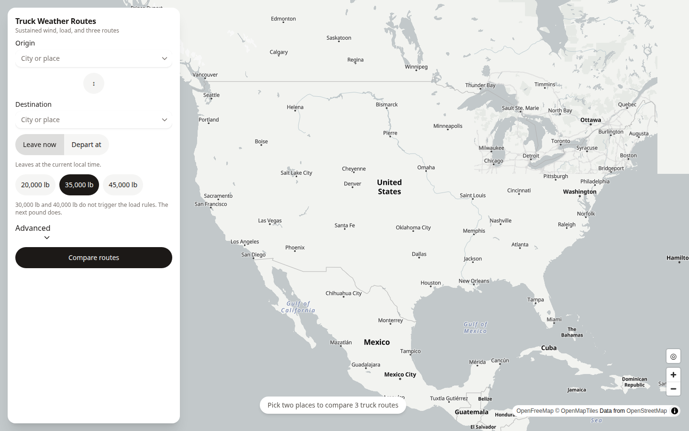
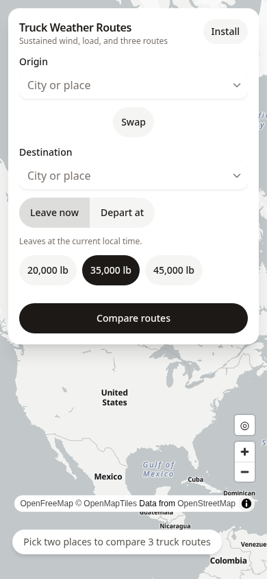
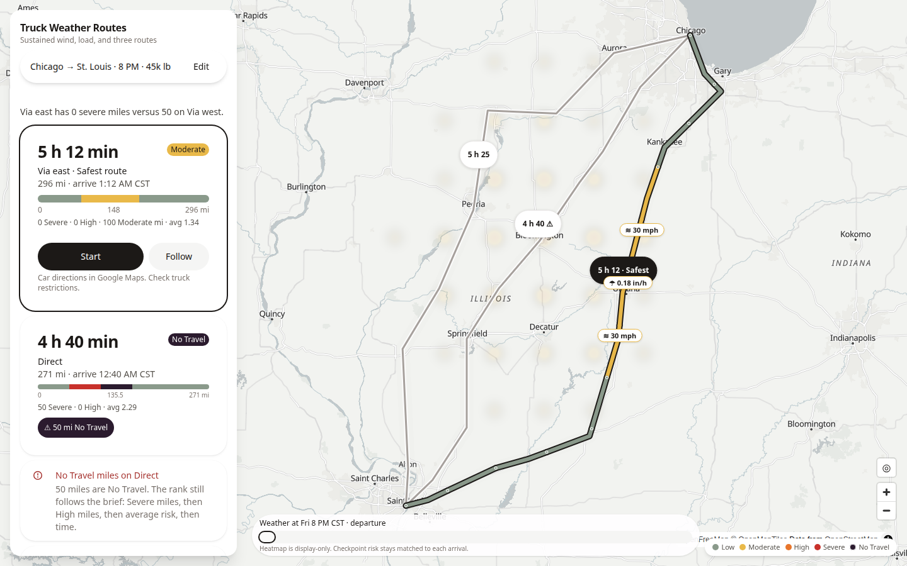
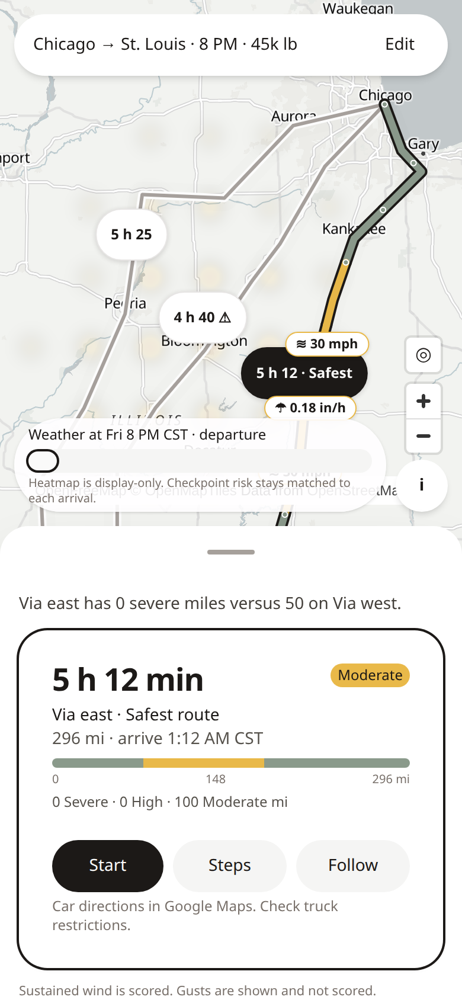
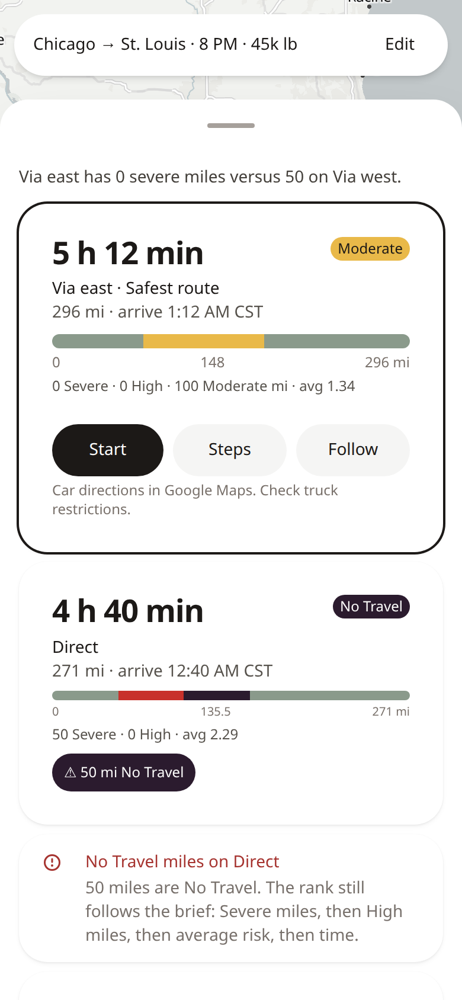
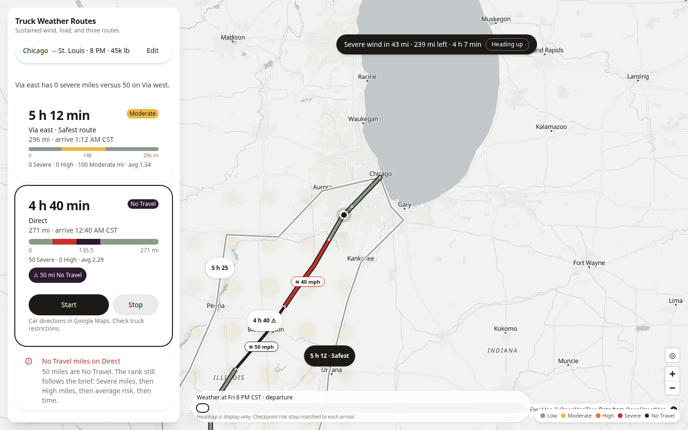
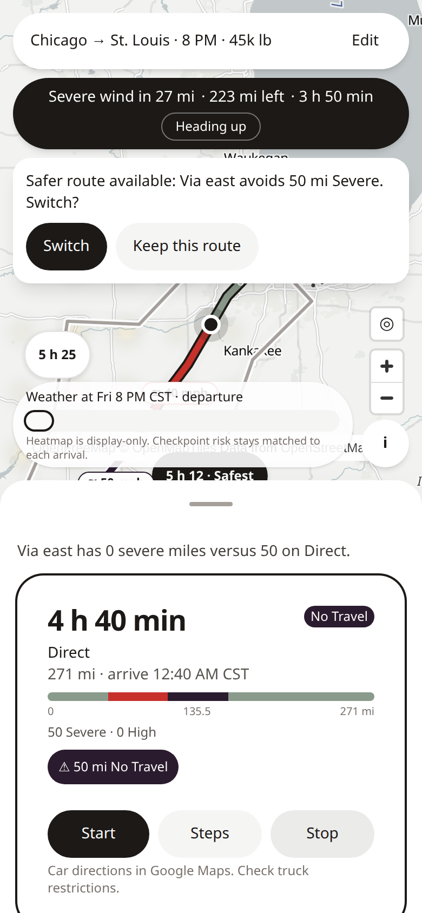
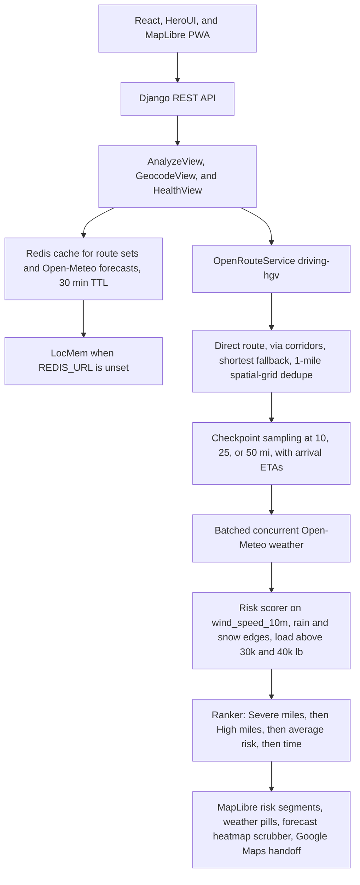
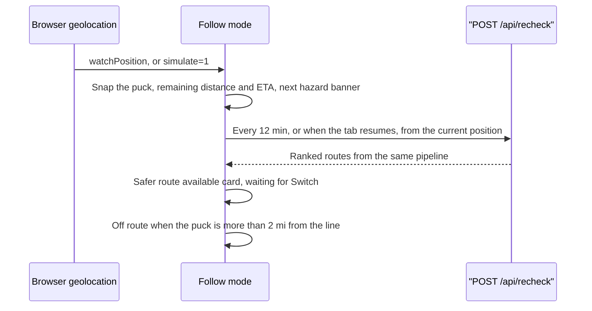

# Weather-aware truck routing

A phone-first map for comparing three truck routes by the weather you will actually meet. You pick an origin, a destination, a departure, and a load. The API asks OpenRouteService for `driving-hgv` options, samples the road every 10, 25, or 50 miles, matches each stop to the Open-Meteo hour you arrive, and ranks the set. The map draws the risk on the line. Start hands the chosen line to Google Maps. Follow stays on this page, watches the truck, and asks again if a safer line shows up.

The design notes, including the rules this ranker keeps, are in [PLAN.md](./PLAN.md).

## Live demo

The web app is [https://fs.kadamsahil.com](https://fs.kadamsahil.com). That host is a Vercel alias of [https://spotter-truck-routes-ten.vercel.app](https://spotter-truck-routes-ten.vercel.app). The API health check is [https://fsapi.kadamsahil.com/api/health](https://fsapi.kadamsahil.com/api/health).

Add `?simulate=1` on the web app to drive the puck along the selected route without a GPS fix. That is the path used for desktop recordings of Follow mode. The query is read when the page loads.

## Screenshots

The phone start screen is a capture of the live site at [https://fs.kadamsahil.com](https://fs.kadamsahil.com). The comparison and follow captures use a synthetic Chicago to St. Louis trip at 45,000 lb in a storm, so every risk tier and the re-check alert are on screen together.

### Start

| Desktop | Phone |
| --- | --- |
|  |  |

### Route comparison

| Desktop | Phone, peek | Phone, list |
| --- | --- | --- |
|  |  |  |

### Follow mode

The phone shot includes the safer-route card. The desktop shot is the same trip with the follow banner over the comparison.

| Desktop | Phone |
| --- | --- |
|  |  |

## Architecture

The browser is a React PWA (HeroUI, MapLibre, Vite). It talks to a Django REST API. `AnalyzeView` runs the trip. `GeocodeView` looks up places. `HealthView` answers the probe. Finished OpenRouteService route sets and Open-Meteo forecasts sit in Redis for 30 minutes. With `REDIS_URL` unset, Django uses its in-process LocMem cache for the same timeout. A Redis call that throws is logged and skipped, so a dead cache still returns a trip.

OpenRouteService is called with `driving-hgv`: a direct route, via corridors offset from that line, and a shortest-preference fallback when three distinct roads are still missing. Overlap uses a 1-mile skeleton and a spatial grid. A new candidate is compared only with routes already kept, and pair results are memoized. Checkpoints land every 10, 25, or 50 miles with arrival ETAs from the provider steps. Weather is fetched in concurrent batches (`wind_speed_10m`, gusts, rain, snow). The scorer uses sustained wind, rain and snow edges, and the load steps above 30,000 lb and 40,000 lb. The ranker orders by Severe miles, then High miles, then average risk, then time. The map paints those segments, weather pills, and a forecast heatmap scrubber. Start opens Google Maps. MapLibre's worker is loaded with `setWorkerUrl` from `maplibre-gl/dist/maplibre-gl-worker.mjs?url`, and `frontend/vercel.json` serves `.mjs` as JavaScript.



Follow mode reads `watchPosition`, or moves the puck itself when the page was opened with `?simulate=1`. The position is snapped to the selected line. The banner shows remaining miles, remaining time, and the next hazard ahead, using sustained wind. The page posts `/api/recheck` with the current position as the origin 1.2 seconds after follow starts, then every 12 minutes, and again when the tab becomes visible. The reply is ranked with the same rules. If another route is now first, a card offers the switch and waits. The selected route stays until the driver taps Switch. More than 2 miles off the line, the banner reads Off route and offers Recheck.



## Project structure

| Path | Role |
| --- | --- |
| `frontend/src/main.tsx` | React entry. |
| `frontend/src/App.tsx` | Trip state, analyze and recheck calls, follow loop, sheet, and banners. |
| `frontend/src/api.ts` | `VITE_API_BASE`, `GET /api/geocode`, `POST /api/analyze`, `POST /api/recheck`. |
| `frontend/src/types.ts` | Request and response types. |
| `frontend/src/follow.ts` | Snap-to-route, next hazard, off-route threshold, safer-route decision. |
| `frontend/src/loading.ts` | Staged loading copy and the 90 second client timeout. |
| `frontend/src/nav.ts` | Google Maps directions URL, at most three waypoints. |
| `frontend/src/segments.ts` | Shared segment helper for the map line and the risk strip. |
| `frontend/src/format.ts` | Miles, clock times, heatmap caption. |
| `frontend/src/riskColors.ts` | Risk colors and the charcoal accent `#1C1917`. |
| `frontend/src/components/TripForm.tsx` | Origin, destination, swap, Leave now / Depart at, load chips, Advanced. |
| `frontend/src/components/Results.tsx` | Safest-route cards, risk strip, No Travel alert, Start. |
| `frontend/src/components/RouteSheet.tsx` | Mobile sheet heights. |
| `frontend/src/components/TripBar.tsx` | Compact trip summary while results are open. |
| `frontend/src/components/HeatmapSlider.tsx` | Forecast scrubber. |
| `frontend/src/components/RiskBadge.tsx` | Worst level present on the summary. Display only. |
| `frontend/src/components/RiskLegend.tsx` | Map legend. |
| `frontend/src/components/RiskStrip.tsx` | One strip of segment miles. |
| `frontend/src/components/InstallButton.tsx` | PWA install prompt. |
| `frontend/src/components/OfflineNotice.tsx` | Offline banner. |
| `frontend/src/map/MapView.tsx` | MapLibre map, routes, puck, follow camera. |
| `frontend/src/map/LazyMap.tsx` | Loads the map off the first paint. |
| `frontend/src/map/markers.ts` | Time bubbles and weather pills. |
| `frontend/src/pwa/lastResult.ts` | Last comparison, stored in the browser. |
| `frontend/src/index.css` | Tailwind and HeroUI styles. |
| `frontend/src/test/` | Vitest for segments, navigation, markers, follow, loading, and the screen. |
| `backend/app/views.py` | `HealthView`, `GeocodeView`, `AnalyzeView`. |
| `backend/app/urls.py` | `health`, `geocode`, `analyze`, and `recheck`, mounted at `/api/` by `backend/config/urls.py`. |
| `backend/app/analyze.py` | Validation, checkpoints, weather join, response shape. |
| `backend/app/routing.py` | OpenRouteService, OSRM, the straight-line fixture, and dedupe. |
| `backend/app/route_cache.py` | 30 minute cache of a finished route set. |
| `backend/app/risk.py` | Wind, rain, snow, load, segment miles, ranker. |
| `backend/app/sampling.py` | Checkpoint placement and arrival ETAs. |
| `backend/app/weather.py` | Open-Meteo client, batches, forecast cache. |
| `backend/app/heatmap.py` | Corridor sample for the 49 hour frames. |
| `backend/app/geo.py` | Distances, Douglas-Peucker, the 1 mile resample. |
| `backend/app/apps.py` | Django app config. |
| `deploy/README.md` | VPS layout, compose, and the timer install. |
| `deploy/fs-truck-deploy.sh` | Pulls `main` and boots a SHA whose CI run succeeded. |
| `deploy/fs-truck-deploy.service` | Oneshot unit for that script. |
| `deploy/fs-truck-deploy.timer` | Runs the unit every 2 minutes. |
| `.github/workflows/ci.yml` | Backend pytest, frontend test, build, and npm audit. |
| `.github/workflows/deploy.yml` | Optional SSH rebuild after CI succeeds on `main`. |

`backend/scripts/bench_dedupe.py` times the old overlap scan against the grid dedupe on synthetic polylines. `Dockerfile` and `docker-compose.yml` at the repo root are what the VPS builds.

## Performance

These timings are from the live API at [https://fsapi.kadamsahil.com](https://fsapi.kadamsahil.com), the 0.5 vCPU container in `docker-compose.yml`. The change that moved them is the 1 mile grid dedupe plus the Redis route-set cache. A warm call is a repeat of the same pins, load, and profile inside 30 minutes.

| Trip | After | Before |
| --- | --- | --- |
| Chicago to St. Louis | 3.4 s cold, 0.38 s warm | about 5.3 s live, 3.9 s local |
| Dallas to Atlanta | 4.0 s | 23.7 s live |
| Salt Lake City to New York | 14.5 s | 113 s, and the previous 60 s timeout |
| `POST /api/recheck` from mile 150 | 2.5 s | |

`backend/scripts/bench_dedupe.py` builds synthetic corridors with no ORS key. Three 20,000 point corridors finish the new dedupe in about 0.9 s on a local CPU. That script is the geometry check. The table above is the production request, including routing and weather, on the half CPU.

Gunicorn's worker timeout is `GUNICORN_TIMEOUT`, default 120 seconds, in `backend/entrypoint.sh`. The browser aborts an analyze at 90 seconds (`ANALYZE_TIMEOUT_MS`) and shows a retry. While the request is open the form says "Finding truck routes…" and, after 2.5 seconds, "Checking weather…".

## API

| Method | Path | Role |
| --- | --- | --- |
| `GET` | `/api/health` | `{"status": "ok"}`. |
| `GET` | `/api/geocode?q=` | Place search. `q` needs 2 characters. |
| `POST` | `/api/analyze` | Full comparison. |
| `POST` | `/api/recheck` | Same view and body, called from the current position. |

Analyze and recheck take `origin`, `destination`, `departure`, `load_lb`, and `sample_miles`. The response carries `units`, `assumptions`, `routes`, `recommendation`, `heatmap`, `warnings`, and `meta`. Field-by-field JSON and the error codes are in [docs/api.md](docs/api.md).

## Rules and the screen

Wind that sets a color is sustained `wind_speed_10m`, stored as `wind_mph` and `wind_used_mph`. Gusts (`wind_gusts_10m` / `gust_mph`) are secondary text. `backend/app/risk.py` scores sustained wind only.

Sustained wind: 55 mph and above is No Travel, 45 is Severe, 35 is High, 25 is Moderate, and below 25 is Low. Rain uses inches per hour: above 1.00 is No Travel, 0.50 is Severe, 0.25 is High, 0.10 is Moderate. A value that sits on a shared edge takes the worse class, so 0.25 is High, 0.50 is Severe, and 1.00 stays Severe. Snow uses inches per hour: above 3 is No Travel, 2 is Severe, 1 is High, 0.5 is Moderate.

Load looks at the same sustained number. From 45 mph up to 55, a load above 30,000 lb becomes No Travel (`45mph_over_30000`). From 35 mph up to 45, a load above 40,000 lb becomes Severe (`35mph_over_40000`). 30,000 lb and 40,000 lb themselves do not trigger. The next pound does. The form says that under the chips.

The ranker sorts usable routes by fewest Severe miles, then fewest High miles, then lowest mile-weighted average risk, then shortest travel time, then route id. Miles are compared to a tenth and average risk to a hundredth. No Travel miles are summed, shown on the card, and repeated in an alert. The order above does not use them. The alert reads: "The rank still follows the brief: Severe miles, then High miles, then average risk, then time."

The screen follows a Google Maps baseline so orange and red mean weather. The accent is charcoal `#1C1917`. The selected line has a charcoal casing and a risk-colored core. Other lines stay quiet. Travel time is the large type on each card. The route named by `recommendation.route_id` is labeled "Safest route", and the list is drawn in API order. The risk strip and the map line share one segment helper: each stretch takes the worse of its two ends, and the miles per level match `summary`. The badge is the worst level that actually has miles. A trip that is only Moderate reads Moderate.

Start opens Google Maps driving directions with at most three waypoints. A Via route sends one midpoint. Any other label sends points at 33% and 66%. The caption is "Car directions in Google Maps. Check truck restrictions." Follow mode is the in-app drive described above. The heatmap scrubber is labeled from the departure hour in the origin timezone. Its caption is "Heatmap is display-only. Checkpoint risk stays matched to each arrival."

## Environment variables

| Variable | Read by | Meaning |
| --- | --- | --- |
| `DJANGO_DEBUG` | `backend/config/settings.py`. Compose sets `0`. `backend/.env.example` uses `1`. | `1` turns debug on. Anything else is off. Debug off refuses a placeholder secret. |
| `DJANGO_SECRET_KEY` | `settings.py`, both `.env.example` files. | Required when debug is off. Refused values: empty, `change-me`, `dev-only-change-me`, `dev-only-not-for-production`. |
| `DJANGO_ALLOWED_HOSTS` | `settings.py`, compose, root `.env.example`. | Comma-separated hosts. Wins over `ALLOWED_HOSTS`. |
| `ALLOWED_HOSTS` | `settings.py` fallback. | Used only when `DJANGO_ALLOWED_HOSTS` is unset. Default `localhost,127.0.0.1`. |
| `LOG_LEVEL` | `settings.py`, compose, root `.env.example`. | Django log level. Default `INFO`. |
| `WEB_CONCURRENCY` | `backend/entrypoint.sh`, compose, root `.env.example`. | Gunicorn workers. Default `1`. |
| `GUNICORN_THREADS` | `entrypoint.sh`, compose, root `.env.example`. | Threads per worker. Default `2`. |
| `GUNICORN_TIMEOUT` | `entrypoint.sh`. | Worker timeout in seconds. Default `120`. |
| `CORS_ALLOWED_ORIGINS` | `settings.py`, both `.env.example` files. | Comma-separated browser origins. Dev default is `http://localhost:5173,http://127.0.0.1:5173`. |
| `ROUTING_PROVIDER` | `backend/app/routing.py`, both `.env.example` files. | `ors`, `fixture`, or `osrm`. Empty plus an `ORS_API_KEY` selects ORS. Empty and no key selects the fixture. |
| `ORS_BASE_URL` | `routing.py`, both `.env.example` files. | Directions host. Default `https://api.heigit.org/openrouteservice`, so the path is `/v2/directions/driving-hgv` on that prefix. If that host fails, set `https://api.openrouteservice.org`. |
| `ORS_API_KEY` | `routing.py`, both `.env.example` files. | OpenRouteService key. Never commit a real one. Empty runs the straight-line fixture. |
| `REDIS_URL` | `settings.py`. Compose sets `redis://redis:6379/0`. | Redis cache. Unset uses LocMem at the same 1800 second timeout. |
| `VITE_API_BASE` | `frontend/src/api.ts`. | API origin with no trailing slash. Unset, the UI calls `/api` on the same host. The Vite dev server proxies that to `http://127.0.0.1:8000`. Point this at `http://127.0.0.1:8002` when the UI should use compose. |
| `ENV_FILE` | `docker-compose.yml`. | Env file passed to the API service. Default `.env`. The VPS sets `/opt/fs-truck/.env`. |
| `IMAGE_TAG` | `docker-compose.yml`. | Image tag for `fs-truck-api`. Default `latest`. Deploys use a 12 character SHA. |

Root `.env.example` is the compose file. `backend/.env.example` is the one next to `manage.py`.

## Local development

API, from `backend/`:

```bash
python3 -m venv .venv
source .venv/bin/activate
pip install -r requirements-dev.txt
cp .env.example .env
python manage.py runserver
```

`requirements.txt` is what the image installs. `requirements-dev.txt` adds pytest. Leave `ORS_API_KEY` empty until you have one. The process listens on port 8000.

UI, from `frontend/`:

```bash
npm ci
npm run dev
```

The dev server proxies `/api` to `http://127.0.0.1:8000`.

Docker, from the repo root. Compose sets `DJANGO_DEBUG=0`, so replace `DJANGO_SECRET_KEY` before the first boot. Placeholder secrets will not start.

```bash
cp .env.example .env
docker compose -p fs-truck up -d --build
```

That publishes `127.0.0.1:8002`. The UI then needs `VITE_API_BASE=http://127.0.0.1:8002`. The VPS layout is in [deploy/README.md](./deploy/README.md).

## Twelve-factor

| Factor | Where it shows up |
| --- | --- |
| Codebase | One repo. `Dockerfile` and `docker-compose.yml` at the root are what the VPS builds. |
| Dependencies | `backend/requirements.txt` in the image. `requirements-dev.txt` for pytest. `frontend/package-lock.json` via `npm ci`. |
| Config | Environment variables in the table above. Debug off refuses a missing or placeholder `DJANGO_SECRET_KEY`. Hosts come from `DJANGO_ALLOWED_HOSTS`, with `ALLOWED_HOSTS` as the fallback. |
| Backing services | Redis through `REDIS_URL`. Unset, the cache stays in process. OpenRouteService and Open-Meteo are reached over HTTP. The key stays in the environment. |
| Build, release, run | Image `fs-truck-api:<12-char SHA>`. The timer in `deploy/` releases only a SHA whose CI run succeeded. |
| Processes | One stateless gunicorn process. Trips are not written to disk. |
| Port binding | The container binds `8000`. Compose publishes `127.0.0.1:8002`. |
| Concurrency | `WEB_CONCURRENCY` (default 1) and `GUNICORN_THREADS` (default 2) in `backend/entrypoint.sh`. |
| Disposability | `--graceful-timeout 10`, `--max-requests 500` with jitter 50, and `stop_grace_period: 20s`. |
| Dev/prod parity | Local `docker compose up` uses this same compose file and image. The UI stays `npm ci`. |
| Logs | Django `LOGGING` writes to stdout. `LOG_LEVEL` defaults to `INFO`. Gunicorn access and error logs also go to stdout. |
| Admin processes | No separate admin service. One-off commands are `python manage.py` against the same settings. |

## CI/CD and production

[`.github/workflows/ci.yml`](.github/workflows/ci.yml) runs on pull requests and on pushes to `main`. The backend job is Python 3.12 and `python -m pytest`. The frontend job is Node 22, `npm ci`, `npm test`, `npm run build`, and `npm audit --omit=dev --audit-level=high`.

[`.github/workflows/deploy.yml`](.github/workflows/deploy.yml) runs after that CI workflow succeeds on `main`, and on `workflow_dispatch`. It rebuilds the API over SSH when `VPS_HOST`, `VPS_USER`, `VPS_SSH_KEY`, and `VPS_KNOWN_HOSTS` are set, then curls `https://fsapi.kadamsahil.com/api/health`. Missing secrets skip the deploy with a notice.

The VPS also runs a pull-based timer, [`deploy/fs-truck-deploy.timer`](deploy/fs-truck-deploy.timer), every 2 minutes. [`deploy/fs-truck-deploy.sh`](deploy/fs-truck-deploy.sh) fetches `origin/main`, deploys only a SHA whose CI run succeeded, tags `fs-truck-api` with the 12 character SHA, keeps the previous tag, and rolls back if the health check fails. The frontend is the Vercel project behind the hosts in [Live demo](#live-demo). Install steps and the `/opt/fs-truck` layout are in [deploy/README.md](./deploy/README.md).

## Tests

From `backend/` (73 tests):

```bash
python -m pytest
```

From `frontend/` (21 tests):

```bash
npm test
```

The production build, including the MapLibre worker check:

```bash
npm run build
```

That script is `tsc --noEmit`, `vite build`, and `node scripts/check-maplibre-worker.mjs`.

## Attribution

Weather from [Open-Meteo](https://open-meteo.com/) (CC BY 4.0). Routes from [openrouteservice](https://openrouteservice.org/) by HeiGIT, data © OpenStreetMap contributors. Map tiles from [OpenFreeMap](https://openfreemap.org/) / OpenMapTiles / OSM (`https://tiles.openfreemap.org/styles/positron`).
